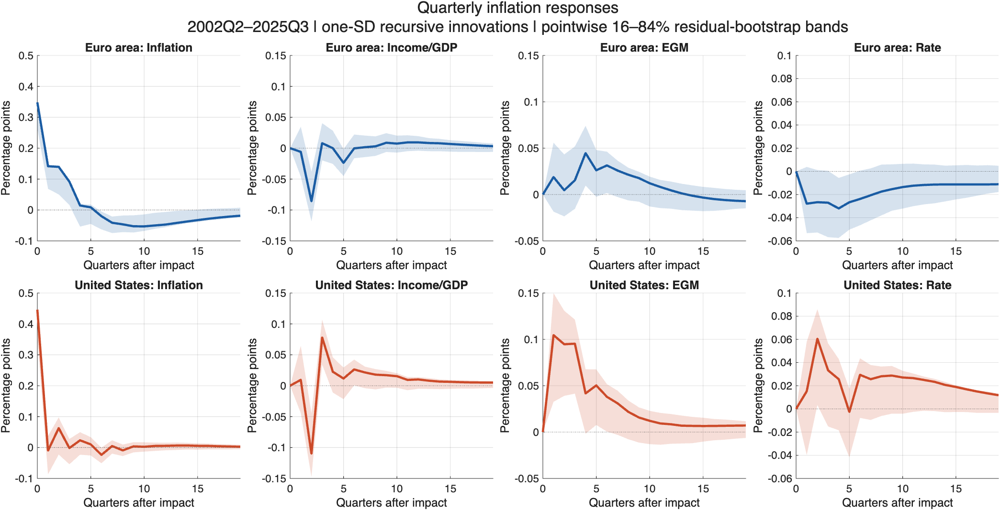
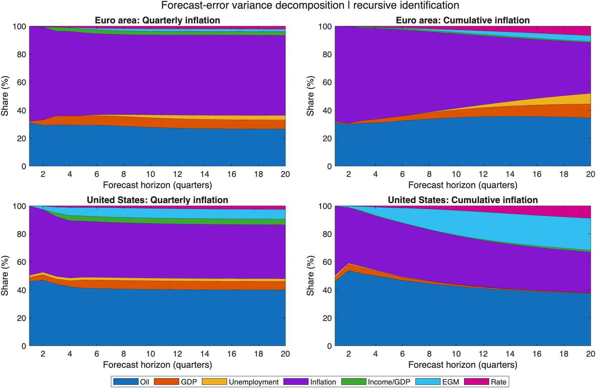
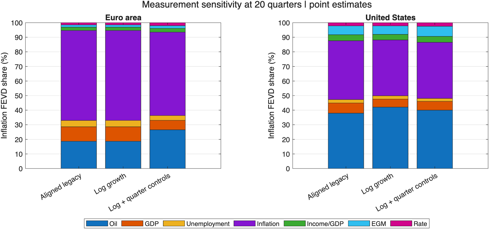

# Inflation Dynamics: Euro Area and United States

Quarterly MATLAB research project comparing inflation, household income, broad money and activity through recursively identified VARs.

**Status: exploratory evidence, not a causal decomposition of pandemic inflation.** Growth definitions and sample dates are aligned. Fixed quarterly controls address seasonal means, but source geography, original aggregation and policy-shock identification remain open issues.

## Research question

How do the dynamics of income, money and prices differ between the euro area and the United States, and how sensitive is that comparison to measurement choices?

The baseline uses a VAR(2), an intercept and three quarterly indicators, estimated separately on **2002Q2–2025Q3** (94 quarters; 92 effective observations). The recursive ordering is:

**Oil → real GDP growth → unemployment → inflation → income/GDP growth → excess money growth → interest rate**

Later innovations cannot affect earlier variables on impact. In particular, inflation's impact response to income, money and rate innovations is zero by construction. Separate country VARs do not identify international spillovers.

## Run

Open MATLAB in the repository root and run:

~~~matlab
main
~~~

Or from a terminal with MATLAB on its executable path:

~~~text
matlab -batch "main"
~~~

The driver loads the existing input snapshot, estimates two baseline models with 1,000 residual-bootstrap draws each, computes four point-estimate sensitivity models, and saves all tables and figures automatically. A fixed random seed (20261010) makes a given configuration reproducible. Source workbooks are read only.

To regenerate only the five current PNG/PDF figures from saved results, run **refresh_figures**. Run main instead after changing model settings, data or estimation code. Figure exports force a light theme, white background and dark text independently of the macOS theme. Historical images in archive/figures are preserved as original records and are not used by the README. Neither command downloads new source data or automatically rewrites the README's numerical discussion.

Tests:

~~~matlab
results = runtests('tests');
assertSuccess(results);
~~~

Validated with MATLAB R2026a. The active pipeline needs readcell, table, prctile, tiledlayout and exportgraphics; it does not use BEAR. Legacy diagnostics optionally use tcdf from Statistics and Machine Learning Toolbox. No data download is required. Running main clears workspace variables and closes figures.

## Project structure

~~~text
main.m                         Entry point and model settings
refresh_figures.m              Re-export figures from saved model results
src/data/                      Workbook dates and growth transformations
src/var/                       Estimation, bootstrap and FEVD; legacy helpers
src/plots/                     Reproducible PNG/PDF exports
tests/                         Date, transformation, FEVD and estimator checks
data/input/                    Original prepared Excel workbooks
data/raw/                      Original source extracts and FRED export
outputs/figures/                Current generated PNG and vector PDF figures
outputs/tables/                 Inputs, FEVD, diagnostics and sensitivity CSVs
outputs/results/               Local baseline.mat and execution log
docs/                          Data dictionary and historical econometric review
experiments/sign_restrictions/  Unvalidated prototypes, outside baseline path
archive/                       Earlier script, figures and editor backups
~~~

Only src/ is added to MATLAB's path. Archived scripts and experimental sign restrictions are not executed by main. The original duplicate lowercase readme.md entry was removed from Git's index; README.md is the canonical document.

## Measurement

| Variable | Euro area | United States |
| --- | --- | --- |
| Oil | Log growth of BFO price | WTISPLC percentage growth converted to log growth |
| Real GDP | Log growth from levels | GDPC1 percentage growth converted to log growth |
| Unemployment | Rate in levels | UNRATE in levels |
| Inflation | Log growth of HICP | CPIAUCSL percentage growth converted to log growth |
| Income/GDP | Log growth of nominal disposable income / nominal GDP | Log growth of DSPI/GDP |
| EGM | Log growth of M3 minus log growth of real GDP | Log growth of M2 minus log growth of real GDP |
| Interest rate | Three-month Euribor | Federal funds rate |

All log growth rates are multiplied by 100, quarterly and not annualised. US EGM is reconstructed by recovering money percentage growth before converting its two components separately. See the [data dictionary](docs/data-dictionary.md) for formulas and source identifiers.

HICP EA19 is not seasonally adjusted; CPIAUCSL is seasonally adjusted. Both models include fixed quarterly controls, preserving their calendar in the bootstrap. **These controls are not equivalent to official seasonal adjustment.** The inherited quarterly aggregation procedure and EA geographic composition still require source-level verification. Data vintages are not documented in the original exports.

FISC is now labelled Income/GDP: it reflects household income relative to output, including endogenous income and automatic stabilisers. EGM is broad-money growth relative to output growth, not a direct measure of QE or debt monetisation. Their innovations should not automatically be called policy shocks.

## Current figures and results

### Inflation responses with uncertainty

Panels use the same vertical scale across regions for each innovation. Responses are to one-standard-deviation innovations, whose economic sizes differ between countries. Bands are pointwise 16th–84th percentiles from a conventional residual bootstrap; they do not establish that the difference between countries is statistically significant.

[Cumulative inflation responses, PDF](outputs/figures/irf_cumulative.pdf) show log-price responses separately. Raw IRFs remain the input to quarterly-inflation FEVD.

### Variance decomposition

At a 20-quarter forecast horizon:

| EGM share | Euro area | United States |
| --- | ---: | ---: |
| Quarterly inflation | 1.84% | 6.96% |
| Cumulative inflation / log prices | 4.25% | 22.81% |

These are conditional point estimates, not percentages of realised pandemic inflation attributable to monetary policy. An own-price innovation share is not a measure of inflation inertia. Historical attribution would require a historical decomposition and a defensible identification strategy.

### Sensitivity to the measurement changes

| Specification, same dates | EA: EGM inflation share | USA: EGM inflation share |
| --- | ---: | ---: |
| Aligned legacy transformations | 1.57% | 6.09% |
| Consistent log growth | 1.57% | 5.83% |
| Log growth + quarterly controls | 1.84% | 6.96% |

The country difference remains in the point estimates. This is a limited sensitivity exercise, not comprehensive robustness or causal evidence.

[Model input series](outputs/figures/model_inputs.png) show inflation and EGM before deterministic controls. All five figures are saved as PNG and vector PDF; [CSV outputs](outputs/tables/sensitivity.csv) and [diagnostics](outputs/tables/diagnostics.csv) provide underlying values.

## Diagnostics and inference limits

The baseline has 18 regressors per equation. Maximum companion roots are approximately 0.96997 (EA) and 0.87919 (USA). Among 1,000 bootstrap replications, 24 EA draws and 1 US draw have roots at least one. These draws are retained for finite-horizon inference and their counts are exported; none are silently discarded.

The covariance convention remains residual covariance divided by T−1 to keep the measurement comparison consistent with the previous implementation. This is not a degrees-of-freedom-adjusted estimator. The residual bootstrap assumes exchangeable innovations over time and does not account for pandemic volatility changes. Its coverage has not been validated here.

Six regression tests passed, including a synthetic quarterly-controls model, agreement with the legacy estimator without seasonal controls, a known analytical FEVD, transformation identities and bootstrap cumulation. The complete estimation and figure-export pipeline was executed successfully. Successful execution does not establish econometric validity.

## Next research steps

1. Verify original aggregation, source vintages and EA geography; rebuild a fully documented source-level dataset.
2. Assess residual serial correlation, seasonal stability, lag order and pandemic volatility; compare justified orderings and common shock normalisations.
3. Decide whether the central objective is exploratory dynamics or causal policy effects. The latter needs stronger identification and appropriate fiscal/monetary variables.
4. Consider a parsimonious BVAR with pandemic-volatility treatment before expanding to TVP-VAR. Add consumption/savings or energy mechanisms selectively.
5. Keep forecasting and machine learning as a separate out-of-sample research design.

## Selected literature

- [Lenza and Primiceri, How to estimate a VAR after March 2020](https://www.ecb.europa.eu/pub/pdf/scpwps/ecb.wp2461~fe732949ee.en.pdf): pandemic volatility.
- [Blanchard and Perotti (2002; working-paper version)](https://www.nber.org/papers/w7269): identification of government spending and tax shocks.
- [Kilian (2009), Not All Oil Price Shocks Are Alike](https://www.aeaweb.org/articles/pdf/doi/10.1257/aer.99.3.1053): oil supply versus demand.
- [Fry and Pagan (2011)](https://pubs.aeaweb.org/doi/abs/10.1257/jel.49.4.938): limitations of sign restrictions.
- [Arias, Rubio-Ramírez and Waggoner (2018; earlier working paper)](https://www.federalreserve.gov/pubs/ifdp/2014/1100/ifdp1100.pdf): inference with sign and zero restrictions.
- [Giannone, Lenza and Primiceri (2015; working paper)](https://www.ecb.europa.eu/pub/pdf/scpwps/ecbwp1494.pdf): Bayesian shrinkage.
- [Bernanke and Blanchard, An analysis of pandemic-era inflation in 11 economies (2024)](https://www.brookings.edu/articles/an-analysis-of-pandemic-era-inflation-in-11-economies/): comparative inflation research.
- [BIS Bulletin 67 (2023)](https://www.bis.org/publ/bisbull67.htm): money growth and inflation.

## License

Code is distributed under the [MIT License](LICENSE). Source datasets remain subject to their providers' terms.
